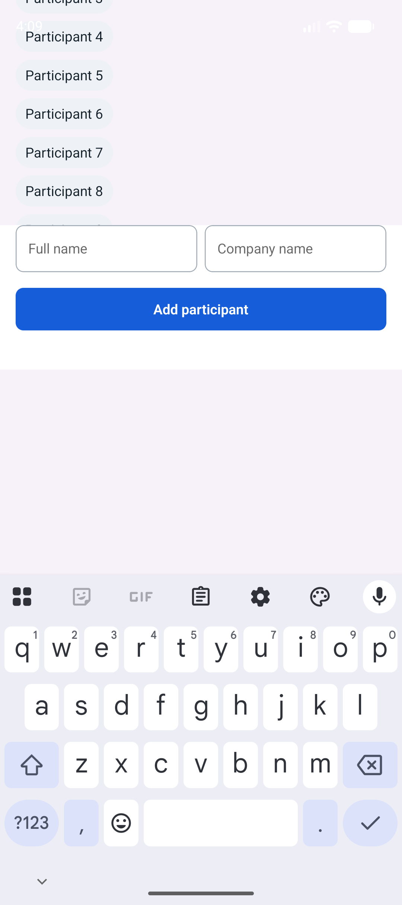
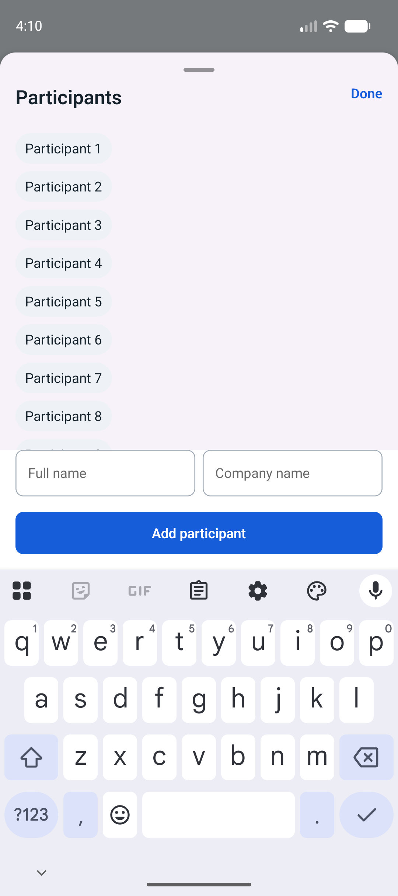

# TrueSheet Android keyboard reproduction

On a Pixel 9 emulator, focusing an input in a TrueSheet absolute footer with Android `adjustPan` moves the sheet header offscreen and leaves a large gap above the keyboard. The same sheet stays in view with `adjustResize`.

## Run

With an Android emulator running and the Android SDK and JDK configured, install the dependencies and run the debug build. The app uses generated native code, so run the debug build on the emulator.

```sh
npm ci
npm run android
```

1. Tap **Open participants**.
2. Use the software keyboard. The app focuses **Full name** when the sheet opens.
3. Wait for the keyboard animation to finish and check the sheet header and the space below **Add participant**.

TrueSheet documents that an absolute footer repositions above the keyboard. [TrueSheet keyboard guide](https://sheet.lodev09.com/next/guides/keyboard#footer-behavior)

## Compare Android keyboard modes

The default build uses Expo's `softwareKeyboardLayoutMode: 'pan'`. Regenerate the Android manifest and rebuild to compare with `resize`. [Expo app configuration](https://docs.expo.dev/versions/latest/config/app/#softwarekeyboardlayoutmode)

```sh
REPRO_KEYBOARD_MODE=resize npx expo prebuild --platform android --no-install
REPRO_KEYBOARD_MODE=resize npm run android
```

To switch back, repeat both commands with `REPRO_KEYBOARD_MODE=pan`.

## Observed on Pixel 9

Android 16 (API 36), Gboard, Expo 57.0.31, React Native 0.86.3, TrueSheet 4.1.2.

| Window mode | Sheet header | Gap from the Add participant button to the keyboard |
| --- | --- | ---: |
| `adjustPan` | Offscreen | 656 screen px |
| `adjustResize` | Visible | 42 screen px |

Both runs used the same JavaScript and a 1080 × 2424 emulator display. The keyboard's top edge was at y = 1541 in both. The change between builds is `android.softwareKeyboardLayoutMode`. The sheet uses a `[0.6, 0.9]` detent array, a registered `ScrollView`, and `footerOptions={{ position: 'absolute' }}`.

| `adjustPan` | `adjustResize` |
| --- | --- |
|  |  |

Is there a supported way to keep the whole sheet visible when the host activity uses `adjustPan`?
